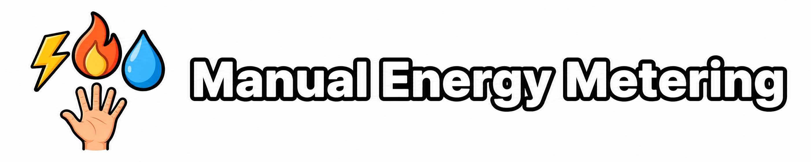

[English documentation](README.md)

*Bitte vergebe einen* :star: *falls du diese Integration nützlich findest!* :blush:

# Manuelle Energiemessung

  

`Manuelle Energiemessung` ist eine benutzerdefinierte Integration für Home
Assistant. Sie richtet sich an Home-Assistant-Nutzer, die ihre Zähler aus
unterschiedlichen Gründen nicht mit einem Lesegerät ausstatten können, das die
Zählerstände automatisch für Home Assistant verfügbar macht.

In einer englischsprachigen Home-Assistant-Oberfläche wird die Integration als
**Manual Energy Metering** angezeigt.

## Kernfunktionen

- Mehrere unabhängige manuelle Zähler mit jeweils eigener Sensorentität und
  Langzeitstatistik anlegen.
- Datierte Zählerstände eintragen, bearbeiten und löschen, auch zwischen
  vorhandenen historischen Zählerständen.
- Den Verbrauch linear zu Stundenwerten für das Energy Dashboard von Home
  Assistant interpolieren.
- Lücken schließen oder über Jahre und Jahrzehnte handschriftlich oder in
  Tabellen geführte Aufzeichnungen übernehmen.
- Zählerstände über eine kompakte Dashboard-Karte eintragen, optional mit
  Fotoerkennung durch ein externes Vision-LLM.
- Zähler als CSV-Dateien exportieren und importieren, einschließlich kompatibler
  Historien aus anderen Home-Assistant-Integrationen.

## Unterstützte Zähler

| Zählertyp | Einheit | Anwendungsbeispiele
| --- | --- | --- |
| Strom | `Wh` oder `kWh` | Hauptstromzähler für Bezug und/oder Einspeisung, PV-Erzeugung |
| Gas | `kWh`, `MWh`, `m³` oder `L` | Gasheizung, Fernwärmestation |
| Wasser | `L` | Hauptwasserzähler, Gartenwasserzähler |

Die Messwerte bleiben im `.storage`-Verzeichnis von Home Assistant erhalten.

<!-- ha-marketplace:exclude-start -->

## Installation

### Marketplace

Der Marketplace ist direkt in Home Assistant integriert. Du kannst **Manual
Energy Metering** ohne GitHub-Konto aus dem Standardkatalog installieren.

1. Öffne als Administrator **Einstellungen > Marketplace** und lies und bestätige
   den Hinweis zu Community-Inhalten, wenn er angezeigt wird.
2. Suche nach **Manual Energy Metering**, öffne den Treffer und wähle
   **Installieren**. Bestätige die Version im Installationsdialog.
3. Falls Home Assistant unter **Einstellungen > System > Reparaturen** einen
   Neustart anfordert, starte vor dem Einrichten der Zähler neu.

[Marketplace-Dokumentation](https://www.home-assistant.io/integrations/marketplace/)

### Alternative: Manuelle Installation über GitHub

1. Öffne auf GitHub die Seite **Releases** dieses Repositorys.
2. Lade unter dem neuesten Release das Archiv **Source code (zip)** herunter und
   entpacke es.
3. Kopiere aus dem entpackten Repository den vollständigen Ordner
   `custom_components/manual_energy_metering` nach
   `<Konfigurationsverzeichnis>/custom_components/manual_energy_metering`.
   Bei Home Assistant OS beginnt dieser Pfad normalerweise mit `/config`. Falls
   `custom_components` noch nicht existiert, lege den Ordner an.
4. Prüfe, dass die Datei anschließend unter
   `<Konfigurationsverzeichnis>/custom_components/manual_energy_metering/manifest.json`
   liegt. Eine zusätzliche Verzeichnisebene aus dem Namen des ZIP-Archivs ist an
   dieser Stelle falsch.
5. Starte Home Assistant vollständig neu.

<!-- ha-marketplace:exclude-end -->

## Zähler einrichten

Schließe nach der Installation die Einrichtung ab, falls sie automatisch
angezeigt wird. Du kannst sie auch unter **Einstellungen > Geräte & Dienste >
Integration hinzufügen > Manuelle Energiemessung** öffnen. Lege für jeden
physischen Zähler einen eigenen Integrationseintrag an.

Anschließend erscheint **Manuelle Energiemessung** im Reiter **Integrationen** als
eigene Kachel. Nach einem Klick auf die Kachel erscheint für jeden angelegten
Zähler ein separater Konfigurationseintrag.

## Aktualisierung

### Aktualisierung über den Marketplace (Home Assistant ab 2026.11)

1. Öffne **Einstellungen > Marketplace** und bestätige gegebenenfalls den Hinweis
   zu Community-Inhalten.
2. Öffne **Einstellungen > Updates**, wähle **Manual Energy Metering** und
   installiere die angebotene Release-Version.
3. Starte Home Assistant vollständig neu, um das Update anzuwenden. Die Erinnerung
   an den Neustart erscheint unter **Einstellungen > System > Reparaturen**.

### Manuelle Aktualisierung

1. Lade das Archiv des gewünschten, vorzugsweise neuesten GitHub-Releases herunter
   und entpacke es.
2. Ersetze den vorhandenen Ordner
   `<Konfigurationsverzeichnis>/custom_components/manual_energy_metering` vollständig
   durch den gleichnamigen Ordner aus dem neuen Release. Kopiere nicht das gesamte
   Repository in `custom_components`.
3. Starte Home Assistant vollständig neu. Ein bloßes Neuladen der Integration
   reicht nach einer Code-Aktualisierung nicht aus.

Die vorhandenen Integrationseinträge müssen für ein Update nicht gelöscht oder
neu angelegt werden. Zählerstände und Konfigurationen liegen außerhalb des
Integrationsordners im Home-Assistant-Speicher und bleiben beim Ersetzen des
Integrationsordners erhalten. Erstelle unabhängig davon vor Home-Assistant-Updates
regelmäßig ein Backup deiner Installation.

## Zählerstände verwalten

Öffne **Einstellungen > Geräte & Dienste**, wähle **Manuelle Energiemessung**
im Reiter **Integrationen** und klicke beim gewünschten Zähler auf das
Zahnradsymbol.

Auf der Verwaltungsseite kannst du Zählerstände eintragen, bearbeiten, löschen
und die vollständige Historie ansehen. Es können auch Zählerstände hinzugefügt
werden, die zwischen zwei vorhandenen Messwerten liegen. Die Interpolationen
werden anschließend entsprechend angepasst.

Über **CSV exportieren** kannst du dort alle erfassten Zählerstände
herunterladen. Wähle beim Hinzufügen eines weiteren Zählers **Exportierte
CSV-Datei importieren**. Du kannst den vorgeschlagenen Zählernamen beim Import
ändern.

Du kannst außerdem die Stundenhistorie eines kompatiblen physischen Zählers von
einer Home-Assistant-Instanz auf eine andere übertragen:

1. Öffne in der Quellinstanz **Einstellungen > Geräte & Dienste > Integration
   hinzufügen > Manuelle Energiemessung**.
2. Wähle **Energy-Dashboard-Zähler exportieren**, anschließend den Zähler und
   Zählertyp sowie eine der verfügbaren CSV-Einheiten und lade die Datei
   herunter.
3. Füge in der Zielinstanz erneut **Manuelle Energiemessung** hinzu und wähle
   **Exportierte CSV-Datei importieren**.

Beim CSV-Import und -Export kannst du Stromzählerstände zwischen `Wh` und `kWh`,
Gasenergie zwischen `kWh` und `MWh` und Gasvolumen zwischen `m³` und `L`
umrechnen. Beim Export der Historie eines physischen Gaszählers sind `kWh` für
Energie und `m³` für Volumen voreingestellt. Wasserhistorien verwenden `L`.
Vorhandene Lücken in der Stundenhistorie bleiben nach dem Import erhalten.
Negative Stundenverbräuche aus fehlerhaften Quelldaten werden als `0`
exportiert. Ihr ursprünglicher Wert bleibt in der CSV-Spalte `original_change`
erhalten und wird außerdem auf der Exportseite aufgeführt.

Zusätzlich stehen unter **Entwicklerwerkzeuge > Aktionen** die Aktionen
`manual_energy_metering.add_reading` und
`manual_energy_metering.delete_reading` für Automatisierungen zur Verfügung.
Zum Löschen ist der exakte gespeicherte Zeitstempel erforderlich.

### Gasvolumen und Energie umrechnen

Multipliziere die Differenz zweier Gaszählerstände mit dem Brennwert und der
Zustandszahl, um die verbrauchte Energie zu berechnen.

**Energie (kWh) = Gasverbrauch (m³) × Brennwert (kWh/m³) × Zustandszahl**

Der Brennwert hängt von der Gaszusammensetzung ab und kann sich mit der Zeit
ändern. Die Zustandszahl rechnet das gemessene Volumen anhand von Druck und
Temperatur auf den Normzustand um.
Verwende die Werte aus der Gasrechnung für den jeweiligen Zeitraum.

Du kannst beide Werte beim Anlegen eines Gaszählers oder später unter
**Neu konfigurieren** frei eingeben. Die bearbeitbaren Standardwerte von
`11,0 kWh/m³` und `0,95` ergeben einen Schätzwert von `10,45 kWh` pro
gemessenem Kubikmeter. Mit diesen Werten ergeben `100 m³` beispielsweise
`1.045 kWh`.

Wenn du beim CSV-Export eines manuellen Zählers zwischen Gasvolumen und Energie
umrechnest, gelten die Einstellungen des Zählers. Beim CSV-Import und beim
Export externer Statistiken kannst du die Faktoren direkt eingeben. Pro CSV
gilt ein Wertepaar für die gesamte Historie. Die Integration speichert die
Zählerstände in der gewählten Zählereinheit.

## Energy Dashboard

Nach mindestens zwei Ablesungen erscheint für den Zähler eine Statistik mit dem
Namen des Zählers. Ihre ID hat die Form
`manual_energy_metering:<interne_zaehler_id>`. Die konkrete ID steht auf der
Verwaltungsseite des Zählers und außerdem im Attribut `statistic_id` der
Sensorentität.

Wähle diese Statistik in **Einstellungen > Dashboards > Energie** passend als
Netzverbrauch, Gasverbrauch oder Wasserverbrauch aus. Verwende für die
rückwirkend interpolierten Daten die Statistik mit dem Präfix
`manual_energy_metering:` und nicht die automatisch vom aktuellen Sensorzustand
erzeugte Statistik `sensor.*`.

Auf der Verwaltungsseite eines Gaszählers kannst du per Häkchen eine
**zusätzliche Entität für das Energy Dashboard** anlegen. Bei Zählern in `L`
oder `m³` entsteht eine kopierbare Statistik-ID für `kWh`, bei Zählern in
`kWh` oder `MWh` eine für `L`. Die Statistik verwendet Brennwert und
Zustandszahl des Zählers. Änderst du einen der beiden Werte, wird die gesamte
umgerechnete Historie neu berechnet. Entfernst du das Häkchen, wird die zweite
Statistik samt Historie gelöscht. Beim erneuten Aktivieren wird sie aus den
gespeicherten Zählerständen neu aufgebaut.

Zwischen zwei Ablesungen wird die Differenz proportional zur tatsächlich
verstrichenen Zeit auf Stundenintervalle verteilt. Angefangene Stunden
erhalten den entsprechenden Teilverbrauch. Vor der ersten und nach der letzten
Ablesung wird kein Verbrauch extrapoliert.

## Dashboard-Karte

Mit der Dashboard-Karte **Manuelle Energiemessung** kannst du einen Zählerstand
direkt im Dashboard eintragen. Füge sie über **Dashboard bearbeiten > Karte
hinzufügen > Manuelle Energiemessung** hinzu und wähle die Zählerentität.

Im Karteneditor können die Foto-Schaltflächen unabhängig vom übrigen
Karteninhalt und unabhängig von einer Provider-Konfiguration ein- oder
ausgeblendet werden.

### Fotoerkennung

Die Fotoerkennung wird für jeden Zähler separat konfiguriert. Richte sie beim
Anlegen des Zählers oder später unter **Einstellungen > Geräte & Dienste >
Manuelle Energiemessung > Neu konfigurieren** ein.

Trage die Adresse eines OpenAI-kompatiblen Vision-Providers ein, zum Beispiel
`http://192.168.1.10:11434` für Ollama, sowie ein API-Token, falls der Provider
eines benötigt. Modell und Prompt sind vorausgefüllt und können für jeden Zähler
angepasst werden. Auch die Bildkomprimierung lässt sich pro Zähler ein- oder
ausschalten.

Wähle für **Foto hochladen** in der Dashboard-Karte zwischen **Nur Datum** und
**Datum und Zählerstand**. Der Browser merkt sich die Auswahl je Zähler auch
beim Neuladen der Seite. Bei **Nur Datum** liest der Browser den
Aufnahmezeitpunkt aus den Fotometadaten. Fehlt diese Angabe, bleibt der bisherige
Ablesezeitpunkt im Formular stehen. Trage den Zählerstand manuell ein. Ohne
konfigurierten Provider ist der Schalter ausgegraut und der Upload verwendet
**Nur Datum**.

**Datum und Zählerstand** und **Foto aufnehmen** senden das Bild zur Erkennung
an den konfigurierten Provider. Die Integration speichert es nicht dauerhaft.
Für den Provider können eigene Speicher- und Datenschutzregeln gelten. Der
Fortschrittsbalken zeigt den aktuellen Schritt und markiert bei einem Fehler
den zuletzt erreichten Schritt. Bei einem Upload verwendet das Formular den
Aufnahmezeitpunkt, falls er verfügbar ist. Sonst verwendet es die aktuelle Zeit.

Prüfe den Zählerstand und das Ablesedatum und wähle **Zählerstand eintragen**,
um den Datensatz zu speichern.

Die Integration enthält die Karte und registriert sie automatisch. Lade den
Browser neu, falls die Karte nach der Einrichtung in der Kartenauswahl fehlt.
Starte nach einem Integrationsupdate zuerst Home Assistant vollständig neu.

## Zeitangaben und Entitätsverlauf

`recent_readings` und `last_reading_timestamp` sind Attribute der jeweiligen
Sensorentität und keine eigenen Menüpunkte. Du findest sie so:

1. Öffne **Entwicklerwerkzeuge > Zustände**.
2. Suche die Sensorentität des Zählers, zum Beispiel `sensor.wasserzaehler`.
3. Öffne beziehungsweise erweitere die Entität und lies ihre Zustandsattribute.

`recent_readings` enthält dort die letzten 50 Ablesungen mit Wert und gespeichertem
Ablesezeitpunkt. `last_reading_timestamp` enthält den Zeitpunkt der neuesten
Ablesung.

Alle Ablesungen speichert Home Assistant intern in einer Datei unter
`<Konfigurationsverzeichnis>/.storage/manual_energy_metering.<interne_zaehler_id>`.
Das Verzeichnis `.storage` ist versteckt und gehört zur internen Datenhaltung von
Home Assistant. Für die normale Nutzung muss und sollte diese Datei nicht manuell
geöffnet oder bearbeitet werden.

Die normale Home-Assistant-Zustandshistorie einer Sensorentität kann nicht
rückdatiert werden. Sie zeigt deshalb, wann ein Zählerstand in Home Assistant
eingegeben wurde. Das bedeutet nicht, dass der Ablesezeitpunkt verloren ging. Für
rückwirkende Diagramme und das Energy Dashboard wird die separate interpolierte
Langzeitstatistik `manual_energy_metering:*` verwendet.

## Beispiele

Bei einem Wasserzähler mit `1 L` am 1. Januar um 00:00 Uhr und
`25 L` am 2. Januar um 00:00 Uhr entstehen 24 Stundenwerte zu jeweils `1 L`.

Bei einem Stromzähler mit `1000 kWh` am 1. Januar um 00:00 Uhr und `9760 kWh`
am 1. Januar des Folgejahres ergibt sich ein täglicher Verbrauch von
`24 kWh = (9760 kWh - 1000 kWh) / 365 Tage` beziehungsweise ein stündlicher
Verbrauch von `1 kWh`.

## Lizenz

Dieses Projekt wird unter der [MIT-Lizenz](LICENSE) veröffentlicht. Sie erlaubt
insbesondere die private und kommerzielle Nutzung, Änderung, Weiterentwicklung und
Weitergabe. Bei Kopien oder wesentlichen Teilen der Software müssen der
Copyright-Hinweis und der Lizenztext erhalten bleiben.

Teile dieses Projekts wurden mit Unterstützung generativer KI, darunter OpenAI
Codex, erstellt und anschließend menschlich geprüft und weiterbearbeitet. Daraus
entstehen keine zusätzlichen Einschränkungen gegenüber der MIT-Lizenz.
